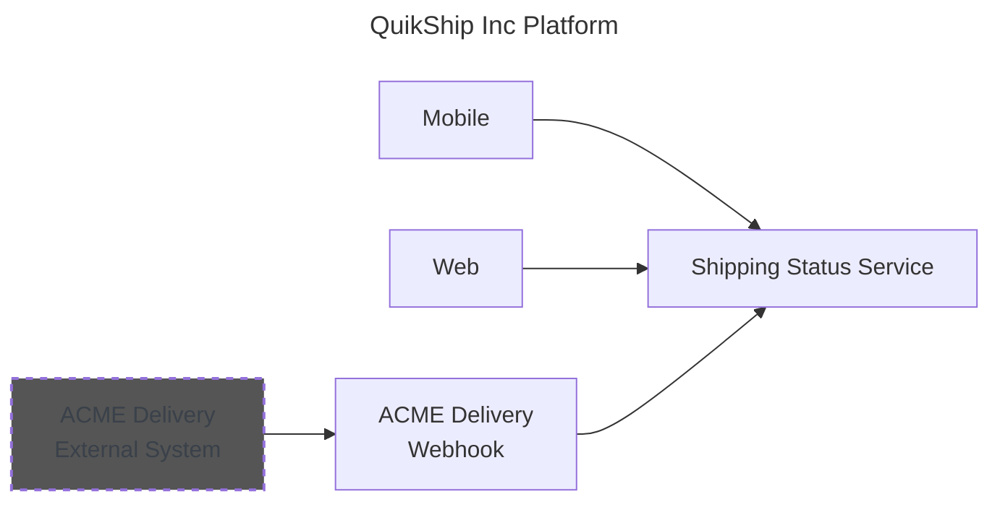

[](https://ifc7.dev)

# [ifc7](https://ifc7.dev): QuickShip Shipping Platform Example

[](LICENSE)
[](https://ifc7.dev)

This is a simple on-demand shipping platform meant to demonstrate designing, building, and maintaining a 
distributed software system using Interface7.

## Architecture

The platform centers around a shipping status service with REST API.



```
Shipping Status API

createShipment:
    POST    /shipments

listShipments:
    GET     /shipments

getShipmentById:
    GET     /shipments/{shipmentId}

updateShipment:
    POST    /shipments/{shipmentId}/updates
```

## Function

There are two types of users **shippers** and **couriers**.

**Shippers** can use the web or mobile app to:

- create new shipments to be delivered. [*createShipment*]
- list the shipments they have created. [*listShipments*]
- check the status of their shipments. [*getShipmentById*]

**Couriers** can use the web or mobile app to:

- list shipments that have not been claimed yet. [*listShipments*]
- claim shipments. [*updateShipment*]
- list shipments that they have claimed. [*listShipments*]
- update the delivery status of their claimed shipments. [*updateShipment*]

## External Integrations

Some high-volume couriers, like ACME Delivery Inc., have their own internal systems to manage their shipments.

QuickShip provides a custom webhook that can be used to consume their internal events.

## IFC7 Helps the Platform Evolve As One

The QuickShip platform has several parts that depend on one another and can change independently. 
This is just a toy example though, real production systems can have hundreds of interdependent parts.

As these change, and new features are added, it is imperative that the interface contracts defined between them
stay in sync, and that breaking changes are handled across all clients before release.

This is where ifc7.dev comes in, providing an easy, collaborative way to build software contract-first, automate most
of the drudgery around compliance, codegen, and more, and enables change without breakage.
